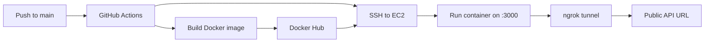

# AWS, Docker & CI/CD User API


A lightweight REST API built with Node.js and Express. The project packages the API in a Docker image and uses GitHub Actions to publish the image to Docker Hub and deploy it to an AWS EC2 instance. At startup, the application also creates a public ngrok tunnel to its local port.

## Table of Contents

- [Features](#features)
- [Technology Stack](#technology-stack)
- [How It Works](#how-it-works)
- [API](#api)
- [Run Locally](#run-locally)
- [Run with Docker](#run-with-docker)
- [Environment Variables](#environment-variables)
- [Continuous Deployment](#continuous-deployment)
- [Project Structure](#project-structure)
- [Limitations](#limitations)
- [Roadmap](#roadmap)
- [Contributing](#contributing)
- [License](#license)
- [Author](#author)

## Features

- Express REST API for basic in-memory user records
- Health-check endpoint
- Docker containerization
- ngrok tunnel created when the server starts
- GitHub Actions deployment to AWS EC2 on pushes to `main`

## Technology Stack

| Area | Tool |
| --- | --- |
| Runtime | Node.js 20 |
| Framework | Express 5 |
| Containerization | Docker |
| CI/CD | GitHub Actions |
| Hosting | AWS EC2 |
| Registry | [Docker Hub](https://hub.docker.com/r/ahmeddevx07/tasks-project) |
| Tunnel | ngrok |

## How It Works

1. The Express server listens on port `3000`.
2. The server starts an ngrok tunnel to port `3000` using `NGROK_AUTHTOKEN`.
3. GitHub Actions builds the Docker image and pushes it to Docker Hub whenever code is pushed to `main`.
4. The workflow connects to the EC2 instance over SSH, pulls the latest image, and replaces the running container.



## API

The deployed API's current base URL is:

```text
https://wildland-generous-tinwork.ngrok-free.dev
```

> **Note:** This is a demo URL served through ngrok. It may go offline at any time (for example, if the tunnel or container restarts). It is public and the API has no authentication, so do not send sensitive data.

For the examples below, set the base URL once:

```bash
export BASE_URL=https://wildland-generous-tinwork.ngrok-free.dev
```

### Endpoints

| Method | Endpoint | Description |
| --- | --- | --- |
| `GET` | `/health` | Returns the application health status. |
| `GET` | `/users` | Returns all users currently held in memory. |
| `POST` | `/users` | Adds the JSON request body as a user. |
| `GET` | `/users/:id` | Returns the user at the specified zero-based array index. |

The `:id` in `GET /users/:id` is an array index, starting at `0`.

### Testing with Postman or Thunder Client

Use Postman or the Thunder Client VS Code extension to test the API. A browser address bar is mainly suitable for `GET` requests; it cannot send the JSON request body needed by `POST /users`, and ngrok may show an interstitial page in a browser. In your API client, use the full URLs below and select **JSON** as the body format for the `POST` request:

- `GET https://wildland-generous-tinwork.ngrok-free.dev/health`
- `GET https://wildland-generous-tinwork.ngrok-free.dev/users`
- `GET https://wildland-generous-tinwork.ngrok-free.dev/users/0`
- `POST https://wildland-generous-tinwork.ngrok-free.dev/users`

Example JSON body for `POST /users`:

```json
{
  "name": "Alex",
  "email": "alex@example.com"
}
```

### Examples

Check application health:

```bash
curl $BASE_URL/health
```

Example response:

```json
{
  "status": true,
  "message": "Application is working fine"
}
```

Add a user:

```bash
curl -X POST $BASE_URL/users \
  -H "Content-Type: application/json" \
  -d '{"name":"Alex","email":"alex@example.com"}'
```

Get all users or the first user:

```bash
curl $BASE_URL/users
curl $BASE_URL/users/0
```

User records are stored in an in-memory array. They are not persisted and are cleared whenever the application restarts.

## Run Locally

### Prerequisites

- Node.js 20 or later
- npm
- An ngrok account and an ngrok auth token

### Setup

1. Clone the repository and open the project directory:

   ```bash
   git clone <repository-url>
   cd awswithdockerwithcicd
   ```

2. Install dependencies:

   ```bash
   npm install
   ```

3. Create a `.env` file in the project root and set your ngrok token:

   ```env
   NGROK_AUTHTOKEN=your_ngrok_auth_token
   ```

4. Start the server:

   ```bash
   npm start
   ```

   For development with Node's watch mode:

   ```bash
   npm run dev
   ```

When running locally, the app creates its own ngrok tunnel and prints that tunnel's URL at startup. Use the printed URL (as `BASE_URL`) to reach your local instance.

## Run with Docker

Build the image from the project root:

```bash
docker build -t awswithdockerwithcicd .
```

Run the container, providing the ngrok token as an environment variable:

```bash
docker run --rm -p 3000:3000 \
  -e NGROK_AUTHTOKEN=your_ngrok_auth_token \
  awswithdockerwithcicd
```

The container's ngrok URL is printed in its logs.

## Environment Variables

| Variable | Required | Description |
| --- | --- | --- |
| `NGROK_AUTHTOKEN` | Yes | ngrok auth token used to create the public tunnel at startup. |

## Continuous Deployment

The workflow at `.github/workflows/deploy.yml` runs on every push to the `main` branch. It builds and pushes `ahmeddevx07/tasks-project:latest` to Docker Hub, then connects to the EC2 host and runs the updated container on port `3000`.

Configure these repository secrets in **Settings → Secrets and variables → Actions**:

| Secret | Purpose |
| --- | --- |
| `DOCKER_USERNAME` | Docker Hub username used to publish the image. |
| `DOCKER_PASSWORD` | Docker Hub password or access token. |
| `EC2_HOST` | Public hostname or IP address of the EC2 instance. |
| `EC2_SSH_KEY` | Private SSH key for connecting to the EC2 instance. |

The EC2 instance must have Docker installed and allow SSH access from the GitHub Actions runner. The workflow expects an environment file at `/home/ubuntu/tasks-project.env` on the instance, containing:

```env
NGROK_AUTHTOKEN=your_ngrok_auth_token
```

> **Security:** Keep tokens and private keys out of source control. The project `.gitignore` excludes `.env`; use GitHub secrets and the EC2 environment file for deployment credentials.

## Project Structure

```text
.
├── .github/
│   └── workflows/
│       └── deploy.yml   # Build, publish, and deploy workflow
├── .dockerignore        # Files excluded from the Docker build context
├── .gitignore           # Local dependencies and environment files
├── Dockerfile           # Node.js container definition
├── package.json         # Project metadata, scripts, and dependencies
├── package-lock.json    # Locked dependency versions
└── server.js            # Express API and ngrok startup
```

## Limitations

- User data is held only in memory and is lost on restart or redeployment.
- The API currently has no database, authentication, or request validation.
- The ngrok tunnel requires a valid auth token and an available ngrok account.

## Roadmap

- [ ] Persistent storage (e.g., PostgreSQL or MongoDB)
- [ ] Request validation and consistent error responses
- [ ] Authentication and authorization
- [ ] Automated tests in the CI pipeline
- [ ] Stable domain / reverse proxy instead of an ngrok tunnel

## Contributing

Contributions are welcome.

1. Fork the repository
2. Create a feature branch: `git checkout -b feature/your-feature`
3. Commit your changes: `git commit -m "Add your feature"`
4. Push the branch: `git push origin feature/your-feature`
5. Open a Pull Request

## License

Add a `LICENSE` file to the repository (for example, MIT) and reference it here, e.g. `Distributed under the MIT License. See LICENSE for details.`

## Author

**Ahmed** — [@ahmeddevx07](https://github.com/ahmeddevx07)